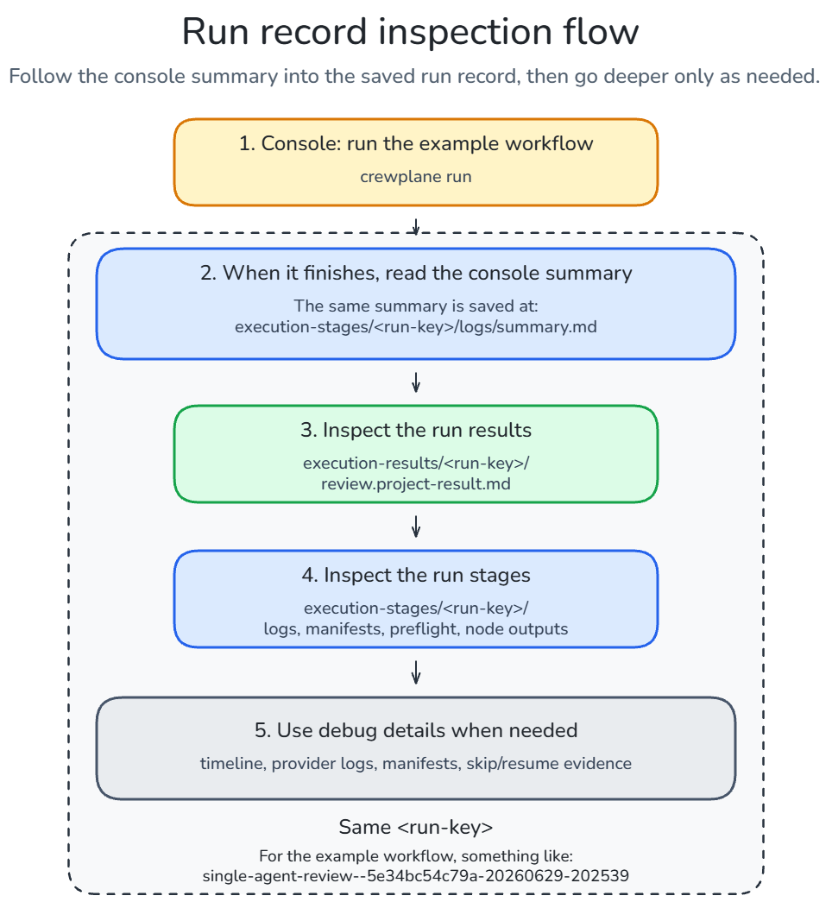
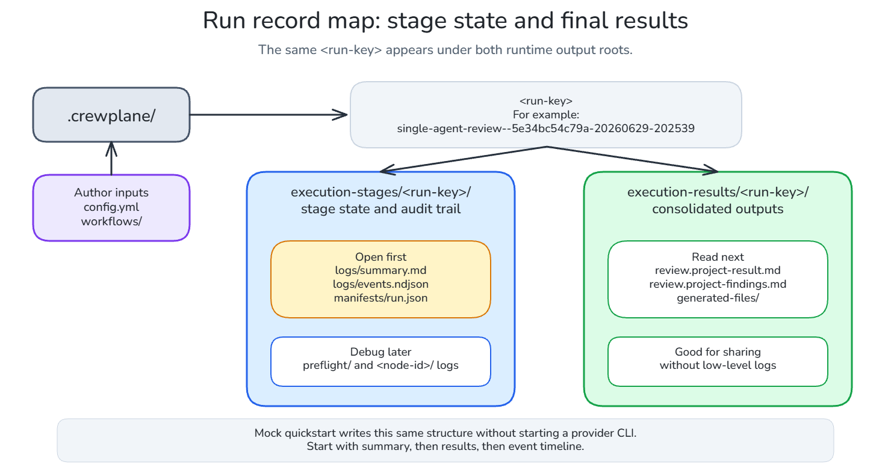

# Quickstart: Run Your First Workflow

After [installing Crewplane](installation.md), follow this guide to set up your
project, run an example workflow, and inspect the files it saves. A workflow is
a set of steps Crewplane runs to complete a task.

New projects start in **mock mode**, which uses built-in sample responses.
This lets you try Crewplane without an AI account, API key, or AI usage charges.
Later, you can connect an AI tool to do real work.

Open a terminal in your project folder and run:

```bash
crewplane init
crewplane validate
crewplane run
```

These commands create the project settings, check the starter workflow, and
run it. The steps below explain what to expect.

## 1. Initialize The Project

```bash
crewplane init
```

`crewplane init` creates a `.crewplane/` folder in your project. It contains:

- `.crewplane/config.yml`: settings for your project and AI tools
- `.crewplane/workflows/`: your workflows and extra examples
- `.crewplane/workflows/single-agent-review.task.md`: the starter workflow used
  in this guide
- `.crewplane/preflight/fingerprint.key`: a key Crewplane uses when checking
  whether it can reuse previous results

In a new project, the starter workflow is the only `.task.md` file directly in
`.crewplane/workflows/`, so Crewplane chooses it automatically when you check
or run a workflow. Extra examples are in
`.crewplane/workflows/example-templates/`; you choose one later by giving its
file path.

You can run `crewplane init` again to create missing files. It leaves existing
files unchanged. Installing AI tools and signing in to them comes later.

## 2. Validate The Workflow

```bash
crewplane validate
```

This command checks the workflow file, its steps, the order they run in, and
their settings. It then shows a preview of the planned run.

With the starter mock settings, this check does not run any AI tools, require
them to be installed, or save run results.

The command should end with output like this:

```text
Preflight: compiled execution plan preview
Valid: 1 nodes across 1 execution wave(s)
```

## 3. Run The Mock Workflow

```bash
crewplane run
```

This runs the starter workflow using sample responses. If `tmux` is installed,
Crewplane opens a live dashboard. Otherwise, it shows progress in the terminal.

A mock run saves logs, step outputs, and final results under `.crewplane/`,
using the same folder layout as a run with a real AI tool. Use the sample
responses to check that your setup works; they are not an AI review of your
project.

The run should start with:

```text
Mock invoker active: no provider CLI commands will be started.
```

When the run finishes, look for a `Run Summary` with a `Run ID` and
`Status: succeeded`:

```text
Run Summary
  Workflow: Single Agent Review
  Run ID: 20260629-202539
  Status: succeeded
  Elapsed: 5.3s
  Nodes: pending=0 running=0 succeeded=1 blocked=0 failed=0
```

The `Stages:` and `Results:` lines show where Crewplane saved the files for
this run:

- `.crewplane/execution-stages/<run-key>/` for logs and details about each step
- `.crewplane/execution-results/<run-key>/` for final results

The `<run-key>` is the folder name for this run. It includes the run ID shown
in the summary.

## 4. Inspect The Run Record

After a successful mock run, you know Crewplane can:

- read your settings and workflow
- plan and run the workflow's steps
- save logs and results under `.crewplane/`

To start writing your own workflows, see
[Workflow Authoring](../guides/workflow-authoring.md). You can compare its
examples with the files from this run.



Start with the terminal summary, then open the saved results. Use the stage
files to see what happened during each step or investigate a problem.
If the terminal output has scrolled away, find the latest run folder:

```bash
ls -1td .crewplane/execution-stages/*/ | head -n 1
```

Example output:

```text
.crewplane/execution-stages/single-agent-review--5e34bc54c79a-20260629-202539/
```

In that example, the run key is
`single-agent-review--5e34bc54c79a-20260629-202539`. Use that value wherever
the docs show `<run-key>`.

Run folders are named `<workflow-name>--<short-id>-<YYYYMMDD>-<HHMMSS>`.
The short ID identifies the workflow and project. The date and time show when
the run started, so you can tell repeated runs apart.

Then list everything that was written:

```bash
find .crewplane/execution-stages -maxdepth 4 -type f | sort
find .crewplane/execution-results -maxdepth 3 -type f | sort
```

This diagram shows where to find each kind of file:



## 5. Onboard A Provider

Crewplane calls the AI tools it works with **providers**. After trying the mock
run, use onboarding to choose the providers you want to use:

```bash
crewplane onboarding
```

The command guides you through setup:

- Looks for supported AI commands your terminal can run.
- Offers `local` when the official Ollama plugin is installed; see
  [Ollama installation](provider-setup.md#local-ollama-text-generation) for what
  you need to install first.
- Asks you to choose at least one provider by entering numbers separated by
  commas, such as `1,2`.
- Updates the starter settings and workflow to use your chosen providers, then
  checks the setup.

Install your AI tools before onboarding, and sign in if they require an account.
For providers such as Codex and Claude, Crewplane checks that their commands
are available; it does not check your account or access to a particular model.

Onboarding leaves files you have edited unchanged. It also leaves your
settings unchanged if you have already switched from mock mode to real
providers. It updates only the starter workflow; extra examples keep their
own provider choices.

For Ollama, start your server first. Select `local`, choose a server and a
downloaded model, then confirm. The list includes only models that generate
text locally. Crewplane saves your choices in `.crewplane/config.yml` and sends
a short test prompt to check that the model works. This may load the model
into memory and use your graphics card.

By default, Crewplane looks for Ollama on the same computer. In Windows
Subsystem for Linux (WSL), it also checks for an Ollama server running in
Windows. You need the Linux Ollama command installed inside WSL; see
[Windows server setup](provider-setup.md#windows-hosted-ollama-from-wsl).
To choose a specific server, set the `OLLAMA_HOST` environment variable to its
address before running onboarding.

Crewplane uses the saved server address for future checks and runs. If the
address changes, update `agents.local.environment.OLLAMA_HOST` in
`.crewplane/config.yml` and run `crewplane validate`.

If the search for servers or models takes too long, Crewplane shows what it
found and tells you the search is incomplete. Give each search up to 60 seconds
by running
`crewplane onboarding --discovery-timeout 60`. See the
[option reference](../reference/commands.md#crewplane-onboarding) for details.

When setup finishes, start your first run with real providers when you are ready:

```bash
crewplane run
```

## Watch A Real Provider Run

To see the same flow with a real provider, watch the Codex walkthrough:

> This video switches from mock mode to Codex by editing the settings file.
> It then runs the workflow with Codex.

<div align="center">
  <video src="https://github.com/user-attachments/assets/01ff3e39-7626-4896-bd18-358f7a15cfcd" controls width="80%" title="First real run demo with Codex"></video>
</div>

> This video shows the full walkthrough: install Crewplane, set up a project,
> try a mock run, inspect the saved files, and connect a real provider.

<div align="center" style="margin-bottom: 0;">
  <video src="https://github.com/user-attachments/assets/b6573226-ba31-473e-aaae-ba3ddca2d3cd" controls width="80%"></video>
</div>

## Try Another Workflow

You can find more examples in `.crewplane/workflows/example-templates/`.
They may use providers you did not choose during onboarding. Before trying an
example, follow the [examples guide](../examples/index.md) to enable the
provider settings it needs and prepare its input files.

To try an example with sample responses, keep mock mode enabled or
[switch back to mock mode](provider-setup.md#turn-mock-mode-onoff). Mock mode
uses sample responses for every provider named in the workflow.

Choose an example by including its path in the command:

```bash
crewplane validate .crewplane/workflows/example-templates/code-review-example.task.md
crewplane run --tasks .crewplane/workflows/example-templates/code-review-example.task.md
```

If you add more `.task.md` files directly to `.crewplane/workflows/`, include
the path of the workflow you want to use in the same way.

For your next real task, try [fixing a reported bug](../examples/bug-fix.md) or
[reviewing an existing change](../examples/review-existing-change.md). Both need
existing code and a description of your task. Replace their sample inputs with
details of the actual bug or change you want Crewplane to work on.

## Next

To change settings by hand, work with files you have already edited, or add
more providers, continue to [Provider setup](provider-setup.md).

Or return to the [documentation index](../index.md).
